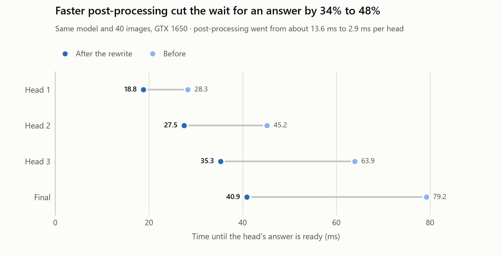
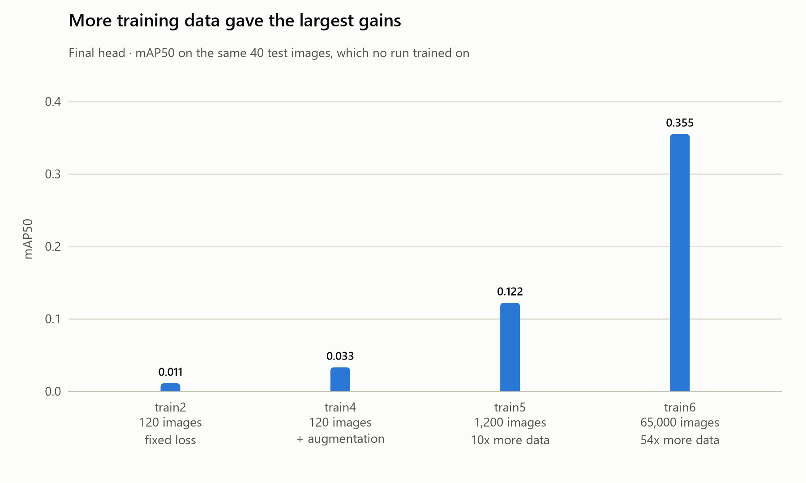
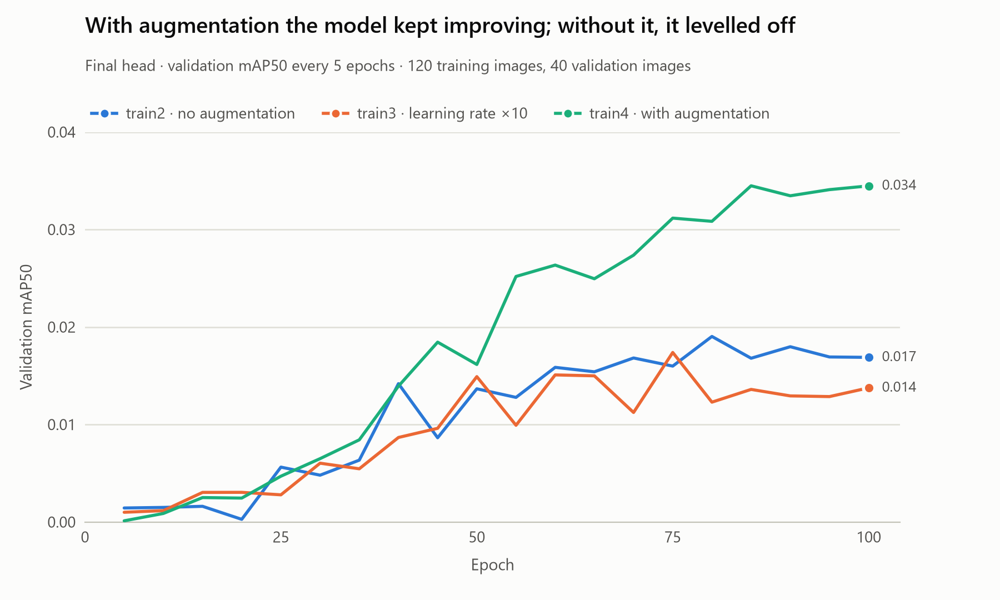
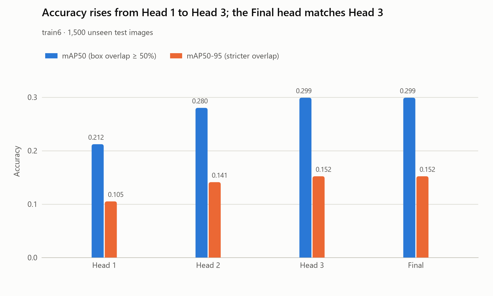
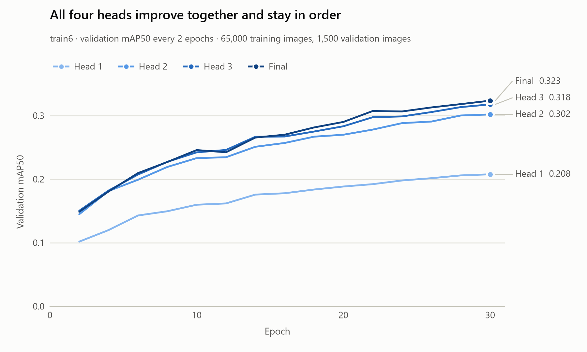
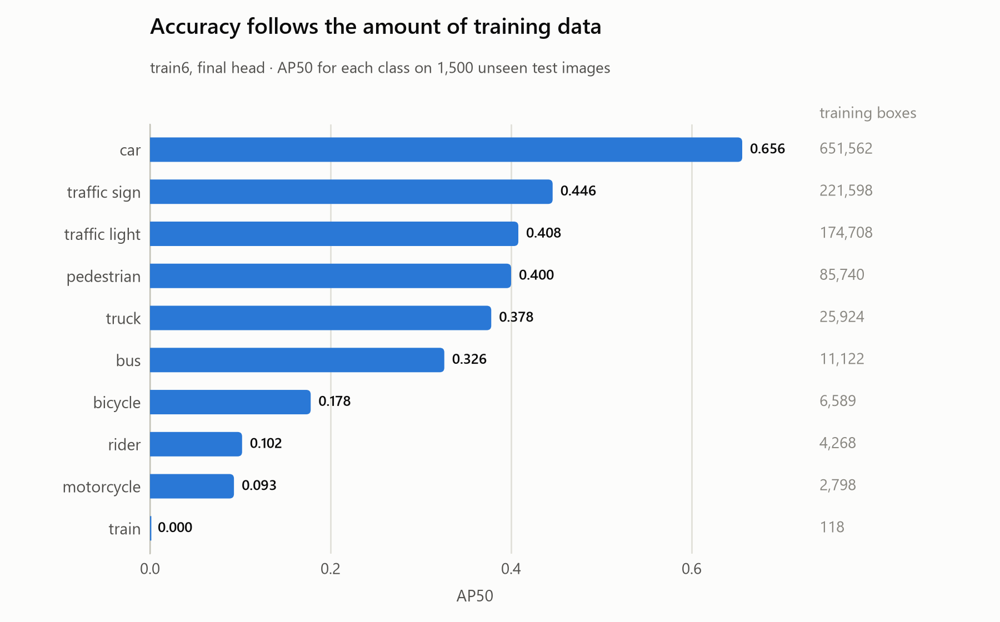
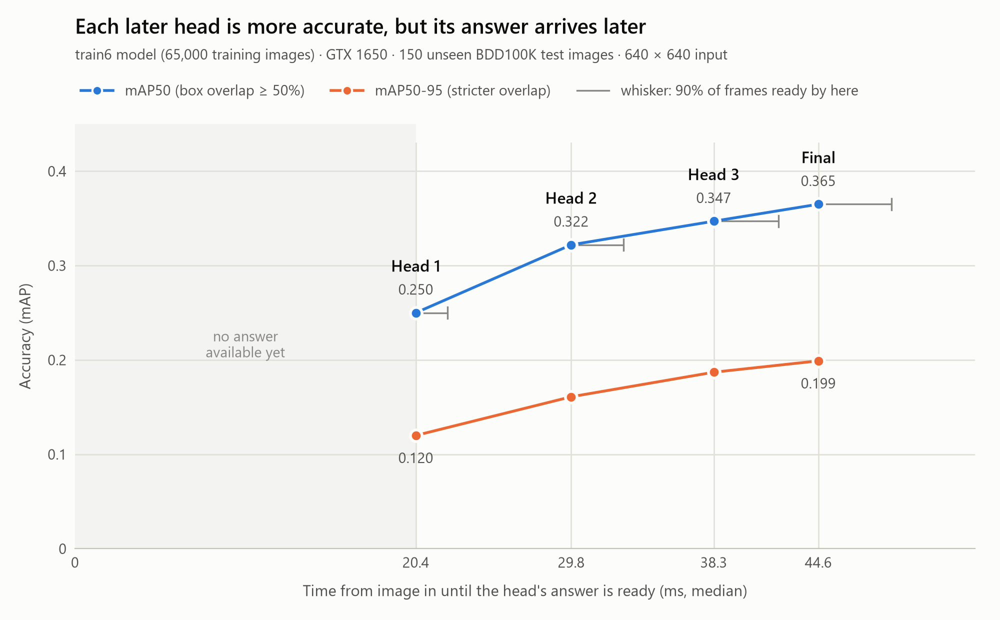
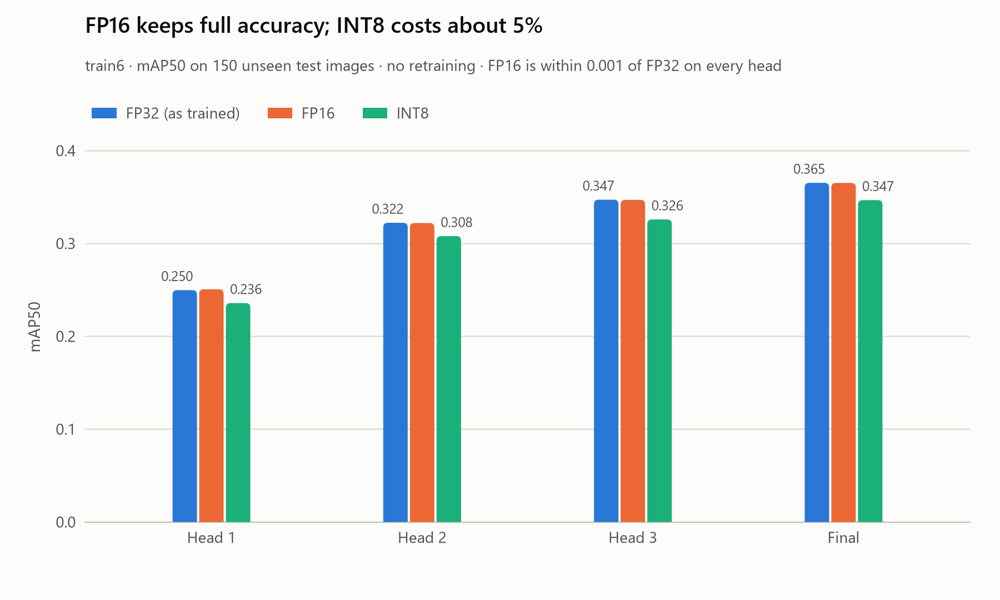
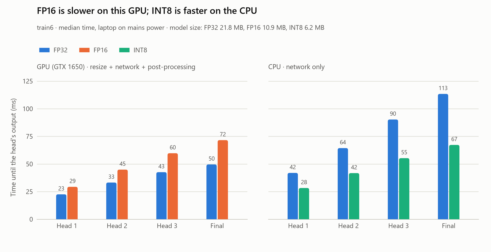
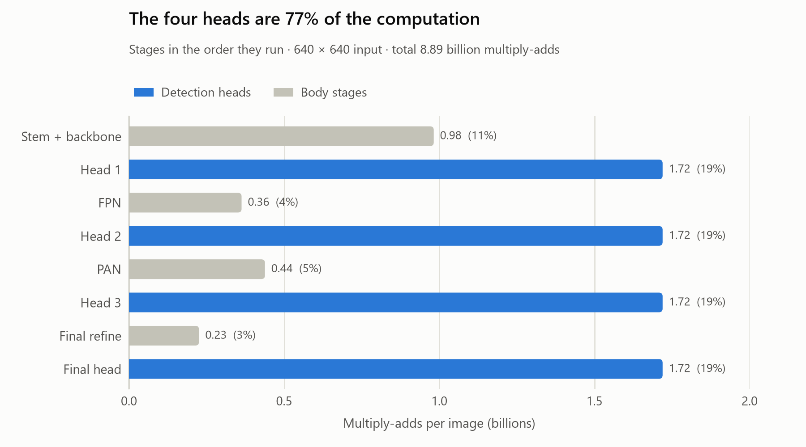

# Interrupt-Driven Anytime YOLO — Explained Simply

(Open in VS Code and press **Ctrl+Shift+V** for a nicely formatted preview.)

Last updated: 2026-10-04. Covers everything up to the `train6` run.

---

## 1. The big idea in one paragraph

A normal object detector (like YOLO) looks at a picture and, after it has
finished **all** of its work, tells you "there is a car here, a person
there". If you need the answer *before* it finishes, you get nothing.

Our detector is different. While it works on a picture, it gives a
**rough answer early**, then a **better answer**, then an **even better
answer**, and finally the **best answer**. Each answer is saved the moment
it is ready. If something urgent happens (a timer runs out, a sensor says
"obstacle closer than 5 m!", or you press Enter), we **immediately grab the
newest saved answer** without stopping or restarting the network.

This is called **"anytime" inference**: you can ask for an answer at *any
time* and you always get the best one available *at that moment*.

**The main goal of the project** is to design an AI accelerator (hardware)
that runs this model. The software here defines and measures the workload
that hardware must run (see §11).

### Everyday analogy

Think of a student writing an exam answer:

- After 5 minutes they write a short rough answer.
- After 10 minutes they improve it.
- After 15 minutes they add detail.
- After 20 minutes they finish the full answer.

If the teacher suddenly says "pens down!", the student hands in **whatever
their latest complete version is**, not a half-written sentence. The
student also doesn't start over. That is exactly what this project does.

---

## 2. The whole system at a glance

```
 ┌───────────────────────────┐
 │  Dataset (BDD100K images) │   road images + label .txt files
 └─────────────┬─────────────┘
               │ load + resize (letterbox to 640x640)
               ▼
 ┌───────────────────────────┐
 │  The model (one pass)     │
 │                           │
 │  Backbone ──► Head 1 ─────┼──► save answer #1  (rough)
 │     │                     │
 │  FPN     ──► Head 2 ──────┼──► save answer #2  (better)
 │     │                     │
 │  PAN     ──► Head 3 ──────┼──► save answer #3  (good)
 │     │                     │
 │  Refine  ──► Final head ──┼──► save answer #4  (best)
 └───────────────────────────┘
                                        │
                                        ▼
                             ┌─────────────────────┐
   INTERRUPT (Enter key, ──► │  "latest answer"    │ ──► returned instantly
   timer, or sensor)         │  (ResultManager)    │
                             └─────────────────────┘
```

There are **two separate jobs running at the same time** (two threads):

1. **The worker**: runs the network and keeps saving newer answers.
2. **The interrupt side**: at any moment, reads the newest saved answer.

The interrupt side **never touches the network**. It only reads the saved
answer, so it is instant.

---

## 3. The data: what goes in

### 3.1 The datasets

All images come from **BDD100K**, a dataset of dash-cam driving images.
Three subsets were used, each bigger than the last. They share **no
images**, so every test set is unseen by every model.

| Name | Train | Val | Test | Where | Used by |
|---|---|---|---|---|---|
| old200 | 120 | 40 | 40 | `C:\Users\abhis\Downloads\archive (2)` | train1–train4 |
| bdd1500 | 1,200 | 150 | 150 | `C:\Users\abhis\Downloads\bdd1500` | train5 |
| bdd70k | 65,000 | 1,500 | 1,500 | on the cluster only (see §8.8) | train6 |

The full BDD100K download (70,000 training images plus the detection
label file) is at `C:\Users\abhis\Downloads\archive (3)`.

Each set has the same layout:

```
<dataset>/
├── train/         images + labels   → used to TEACH the model
├── calibration/   images + labels   → validation: CHECK progress while training
├── test/          images + labels   → final test / live demo
└── data.yaml      → lists the folders and the 10 class names
```

Each image is **1280 × 720** pixels (a normal wide dash-cam frame).

### 3.2 The 10 classes (types of objects)

| id | name | id | name |
|---|---|---|---|
| 0 | pedestrian | 5 | bicycle |
| 1 | rider | 6 | motorcycle |
| 2 | car | 7 | traffic light |
| 3 | bus | 8 | traffic sign |
| 4 | truck | 9 | train |

> **Class names were wrong in the first subset (found 2026-09-30).** The
> `data.yaml` inside `archive (2)` lists the names in a different order
> (truck/bus swapped; train, bicycle, traffic light, traffic sign
> shifted). This was found by cutting out real boxes for each label
> number and looking at them. The label *numbers* were always consistent,
> so every accuracy number stays valid; only printed class *names* from
> train1–train4 are wrong. The table above is the correct order, and
> `bdd1500` and `bdd70k` use it. `archive (2)\data.yaml` and the three
> name lists in the code were corrected on 2026-10-04; the original
> `data.yaml` is kept as `backup_original\archive2_data.yaml.orig`.

### 3.3 The label files (the "answer key")

For every image `abc.jpg` there is a text file `abc.txt`. Each line is one
object. Here is a real line from your data:

```
8 0.119701 0.179408 0.037969 0.042632
│    │        │        │        └── box height  (as a fraction of image height)
│    │        │        └─────────── box width   (as a fraction of image width)
│    │        └──────────────────── box centre Y (fraction, 0 = top, 1 = bottom)
│    └───────────────────────────── box centre X (fraction, 0 = left, 1 = right)
└────────────────────────────────── class id (8 = traffic sign)
```

So this says: "there is a small traffic sign about 12% from the left and
18% from the top, and it is about 4% of the image wide."

### 3.4 Preparing an image: "letterboxing"

The network needs a **square 640 × 640** input, but the photos are
1280 × 720 (wide). If we stretched the photo, cars would look squashed. So
we **letterbox** it (file: `data/yolo_dataset.py`):

```
 Original 1280x720             Shrink by 0.5 → 640x360        Pad to 640x640
 ┌──────────────────┐          ┌──────────┐                  ┌──────────┐
 │                  │   ───►   │  photo   │        ───►      │ grey pad │ 140 px
 │      photo       │          └──────────┘                  │  photo   │ 360 px
 │                  │                                        │ grey pad │ 140 px
 └──────────────────┘                                        └──────────┘
```

The code remembers the **scale (0.5)** and the **padding (140 px)**. After
the model predicts boxes on the 640×640 square, it uses these numbers to
map the boxes **back onto the original 1280×720 photo**. This step is
called "un-letterboxing".

Pixel values are also divided by 255, so they go from 0–255 to 0.0–1.0,
and the image becomes a tensor of shape `(1, 3, 640, 640)`:
1 image, 3 colour channels (R, G, B), 640 high, 640 wide.

### 3.5 Building a new subset (file: `scripts/build_bdd_subset.py`)

The builder picks random images from the full BDD100K download, converts
the labels to the format above with the correct class numbers, and writes
the train / calibration / test folders. It can leave out images that are
already in another set (`--exclude-dir`), which is how the three sets were
kept separate. Example (this is how `bdd1500` was made):

```bash
.venv/Scripts/python -m anytime_yolo_interrupt.scripts.build_bdd_subset --images-dir "C:/Users/abhis/Downloads/archive (3)/bdd100k/bdd100k/images/100k/train" --labels-json "C:/Users/abhis/Downloads/archive (3)/labels/det_v2_train_release.json" --out "C:/Users/abhis/Downloads/bdd1500" --n-train 1200 --n-val 150 --n-test 150 --exclude-dir "C:/Users/abhis/Downloads/archive (2)"
```

After building a set, always look at a few cropped boxes per class to
check the names match. That check is what caught the mix-up in §3.2.

---

## 4. The model architecture (file: `models/gelan_anytime.py`)

The model is a small **YOLOv9 / GELAN-style** detector written from scratch.
It has about **5.45 million** learnable numbers (parameters). It is *not*
the official YOLOv9-T: the blocks, loss and weights all differ.

Two full pictures are in `docs/`: `model_architecture.png` (whole network)
and `head_architecture.png` (one head), each also as `.svg` and `.pdf`.

### 4.1 The Lego bricks (file: `models/common.py`)

| Brick | What it does, in simple words |
|---|---|
| **Conv** | Slides small filters over the image to detect patterns (edges, corners, textures). Followed by BatchNorm (keeps numbers stable) and SiLU (a smooth "on/off" switch). |
| **Down** | A Conv with stride 2. It **halves** the width and height: "zoom out" to see bigger things. |
| **Up** | Doubles width and height by copying pixels: "zoom back in". No learning. |
| **ELAN block** | The main workhorse. Two 1×1 convs split the input into two paths, one path runs through one or two 3×3 convs, then **all the in-between results are joined** and fused by a 1×1 conv. This mixes simple and complex features cheaply. There are 12 in the model. |
| **SPPF** | A 1×1 conv halves the channels, three 5×5 max-pools run in a chain, all four results are joined, and a 1×1 conv restores the channels. It helps the model see large context. Used once, at the end of the backbone. |

### 4.2 Feature maps: P3, P4, P5

The network produces pictures of "features" at **three sizes**:

| Name | Size (for a 640 input) | Stride | Channels | Each cell covers | Good at finding |
|---|---|---|---|---|---|
| **P3** | 80 × 80 | 8 | 64 | 8 × 8 px | **small** objects (traffic lights, far signs) |
| **P4** | 40 × 40 | 16 | 96 | 16 × 16 px | **medium** objects (cars nearby) |
| **P5** | 20 × 20 | 32 | 128 | 32 × 32 px | **large** objects (buses, trucks up close) |

Think of it as looking at the photo through three different "grids": a
fine grid, a medium grid and a coarse grid.

### 4.3 The four stages and the four heads

```
Input image (3 × 640 × 640)
│
│  STAGE A — STEM + BACKBONE  ("look at the image")    27 convs · 0.46 M params
│    Stem:  Conv s2 → Conv s2 → ELAN            → 32 ch, 160×160
│    Down + ELAN                                → P3_bb: 64 ch,  80×80
│    Down + ELAN                                → P4_bb: 96 ch,  40×40
│    Down + ELAN + SPPF                         → P5_bb: 128 ch, 20×20
│
├──────────► HEAD 1  (early_head_1)  — rough answer
│
│  STAGE B — TOP-DOWN FPN  ("share big-picture info downward")  12 convs · 0.13 M
│    P5 → 1×1 conv 128→96 → Up ×2 → join with P4 → ELAN → P4_td
│    P4_td → 1×1 conv 96→64 → Up ×2 → join with P3 → ELAN → P3_td
│    (small-object maps now also know about the big context)
│
├──────────► HEAD 2  (early_head_2)  — better answer
│
│  STAGE C — BOTTOM-UP PAN  ("share fine detail upward")        16 convs · 0.41 M
│    P3_td → ELAN                                     → P3_bu
│    P3_bu → Down 64→96 → join with P4_td → ELAN      → P4_bu
│    P4_bu → Down 96→128 → join with P5_td → ELAN     → P5_bu
│    (large-object maps now also know about precise detail)
│
├──────────► HEAD 3  (early_head_3)  — good answer
│
│  STAGE D — FINAL REFINE  ("one more polishing pass")          12 convs · 0.14 M
│    one ELAN on each of P3, P4, P5
│
└──────────► FINAL HEAD (final)       — best answer
```

**Why do later heads give better answers?** Each later head sees features
that have been processed and mixed more. Head 1 only sees the raw backbone
features. The Final head sees features that went through FPN, PAN *and*
refinement.

**Important:** the network **never stops early**. All 4 stages always run.
The heads are "tap points" where we *peek* at the current features and
save an answer. They are not exit doors.

**The heads do not run in parallel.** Each one needs the features of the
stage before it, so they run one after another and their times add up
(see §6.2).

### 4.4 What a head actually outputs (file: `models/detect_head.py`)

Each of the 4 heads has **its own weights** (about 1.08 M params each).
A head is three **ScaleHeads**, one per grid (P3, P4, P5). Each ScaleHead
has two branches of two 3×3 convs: a class branch and a box branch. For
**every grid cell** the head predicts 15 numbers:

```
10 numbers → class scores   "how much does this look like a car? a bus? ..."
 1 number  → objectness     "is there ANY object centred in this cell?"
 4 numbers → l, t, r, b     "how far is the box edge to the left / top / right / bottom?"
```

Total cells = 80×80 + 40×40 + 20×20 = **8,400 cells**, so each head makes
8,400 guesses per image.

This is **anchor-free**: the model doesn't start from pre-made box shapes.
Each cell simply says "the box around me stretches this far in each
direction".

### 4.5 From 8,400 guesses to a clean list (file: `models/postprocess.py`)

```
8,400 raw guesses
   │  1. Decode: turn l,t,r,b into real box corners (x1, y1, x2, y2)
   │  2. Score = objectness × best class score
   │  3. Throw away anything with score < 0.3
   │  4. NMS (non-maximum suppression): if several boxes overlap
   │     heavily (IoU > 0.5) for the same class, keep only the best one
   │  5. Keep at most 100 boxes
   │  6. Un-letterbox: map boxes back onto the 1280×720 photo
   ▼
Final list, e.g.:  [car, 0.87, (412, 300, 590, 410)], [person, 0.62, ...]
```

> **Speed-up made on 2026-09-28.** The first version did step 4 as a loop
> on the GPU, one box at a time, and each step made the GPU stop and
> report back. That cost about **13.6 ms per head** even with only ~30
> candidate boxes. Now steps 1–2 run on the GPU, the best 1,000 cells are
> copied to the CPU in **one** transfer, and NMS runs in NumPy: about
> **2.9 ms per head**. The detections are identical (320 cases, 17,990
> boxes compared). The old version is in
> `backup_original/postprocess_loop_version.py`.



### 4.6 Size and depth

| Part | Conv layers | of them 3×3 | Parameters | Multiply-adds per image |
|---|---|---|---|---|
| Stem + backbone | 27 | 13 | 0.46 M | 0.98 G |
| FPN | 12 | 4 | 0.13 M | 0.36 G |
| PAN | 16 | 7 | 0.41 M | 0.44 G |
| Final refine | 12 | 3 | 0.14 M | 0.23 G |
| Each head (× 4) | 21 | 12 | 1.08 M | 1.72 G |
| **Whole model** | **151** | **75** | **5.45 M** | **8.89 G** |

- The four heads hold **79% of the parameters** and **77% of the compute**.
- Other layers: 115 BatchNorm, 115 SiLU, 1 max-pool (used 3 times),
  2 upsamples. Only two kernel sizes exist: 3×3 and 1×1.
- Longest chain of convolutions from the image to each answer:
  Head 1 **26**, Head 2 **36**, Head 3 **49**, Final **52**.

**Viewing the network in Netron:** `last.pt` holds only weights, so Netron
shows nothing for it. Export to ONNX first, then open `model.onnx`:

```bash
.venv/Scripts/python -m anytime_yolo_interrupt.scripts.export_onnx --checkpoint runs/anytime_interrupt/train6_bdd70k/last.pt
```

---

## 5. Training: how the model learns (files: `scripts/train.py`, `models/loss.py`)

### 5.1 The training loop

```
repeat for each epoch (one full pass over the training images):
    for each batch of images:
        1. Run the model → get the raw outputs of ALL 4 heads
        2. Compare each head's output with the label files → a "loss" per head
        3. Total loss = 0.3·loss_head1 + 0.5·loss_head2 + 0.7·loss_head3 + 1.0·loss_final
        4. Backpropagation: work out how to nudge every weight to lower the loss
        5. Optimizer (SGD, momentum 0.937) nudges the weights
    every N epochs: measure accuracy of each head on the validation images
    save a checkpoint (last.pt)
```

**Why weight the heads differently (0.3 / 0.5 / 0.7 / 1.0)?** The final
head matters most, so it gets the most weight. But the early heads still
get real training signal, so they learn to give **useful** answers on
their own and don't just become weak copies.

Other details:
- **Learning rate** slowly decreases along a cosine curve (big steps
  early, small careful steps at the end). Laptop runs used batch 4 at
  0.001; `train6` used batch 16 at 0.004, the same rate per image.
- **AMP (mixed precision)** uses 16-bit numbers where safe. That makes it
  faster and uses less memory, which matters on a 4 GB GTX 1650.

### 5.2 How a label is matched to a cell ("target assignment")

For each labelled object:
1. Pick **one grid** by object size: small → P3, medium → P4, large → P5.
2. In that grid, take the cell containing the object's centre, **plus**
   any of its 8 neighbours whose own centre is inside the object's box
   ("centre sampling"). This gives up to 9 positive cells per object.
3. Those cells are the "positives". Each should say "yes, object here,
   it's a car, and the box edges are *this* far away".
4. Every other cell should say "no object here".

(If two objects land on the same cell, the smaller one wins, so small
objects don't get drowned out.)

> **Fix made on 2026-09-27.** The original code used only **one** positive
> cell per object and **averaged** the objectness loss over all 8,400
> cells. With about 20 positives vs 8,400 negatives, the easiest way to
> lower the loss was "say no object everywhere". The model's confidence
> collapsed, so after 40 epochs it still found nothing (mAP = 0). The
> fix: centre sampling (above), plus summing the objectness loss and
> dividing by the **number of positives** (as YOLOX does). In a
> side-by-side test on 8 images, the final head's mAP50 went from 0.155 to
> 0.288, and its top confidence from 0.03 to 0.99. The original files are
> kept in `backup_original/`.

> **Speed-up made on 2026-09-30.** The targets used to be written into GPU
> memory one value at a time, and rebuilt four times per batch (once per
> head). They are now built once on the CPU and shared by all four heads.
> The loss went from **576 ms to 52 ms per batch** with exactly the same
> loss values, gradients and positive cells. A training step dropped from
> about 1.3 s to 0.7 s.

### 5.3 The three parts of the loss (per head)

| Part | Question it trains | Where it's applied |
|---|---|---|
| **Objectness loss** (BCE) | "Is there an object here?" yes/no | every cell (summed, then divided by number of positives) |
| **Class loss** (BCE) | "Which of the 10 classes is it?" | only positive cells |
| **Box loss** (CIoU) | "How well does my box overlap the true box?" | only positive cells |

CIoU is better than plain overlap because it also rewards getting the
**centre position** and the **shape (width/height ratio)** right.

### 5.4 Data augmentation (added 2026-09-29, training images only)

Every training image is changed a little, differently each time, so the
model can't simply memorise the photos:

| Step | What it does |
|---|---|
| **Mosaic** | Stitches 4 random training photos into one image |
| **Zoom and shift** | Zoom 0.5–1.5× and shift ±10% |
| **Colour jitter** | Random hue, saturation and brightness |
| **Horizontal flip** | Mirrors half the images |
| **Close mosaic** | Mosaic is switched off for the last epochs |

Validation and test images are never changed. Preview what the model sees
with `scripts/show_augmentations.py`. Turn it off with `--no-augment`.

### 5.5 Useful training options

| Option | What it does |
|---|---|
| `--weights file.pt` | Start a **new** run from an older model's weights |
| `--resume file.pt` | **Continue** a stopped run (weights, optimizer, epoch and learning-rate schedule) |
| `--workers N` | Number of data-loading processes |
| `--mosaic`, `--close-mosaic`, `--scale`, `--translate`, `--fliplr` | Tune the augmentation |
| `--lr`, `--batch-size`, `--epochs`, `--val-every` | The usual settings |

### 5.6 What training writes to disk

```
runs/anytime_interrupt/<run name>/
├── last.pt                  the trained weights (checkpoint)
├── config.json              the settings you used
├── train_loss_log.jsonl     one line per epoch: loss of every head
└── val_epoch_XXXX.json      precision / recall / mAP50 / mAP50-95 PER HEAD
```

---

## 6. Inference with interrupts: the core of the project

### 6.1 The pieces (folder: `inference/`)

| File | Role, in simple words |
|---|---|
| `anytime_detector.py` | The worker loop: run the trunk once, then heads 1→2→3→Final, saving after each one. **No "stop if interrupted" inside the loop.** Each result records the time it was actually published. |
| `gelan_adapter.py` | Connects the real model to the loop. Each `run_head(i)` does *more* work than the last (backbone → +FPN → +PAN → +refine), so the times you measure are real. |
| `result_manager.py` | The "mailbox" holding the **latest** answer. Thread-safe. |
| `interrupt_manager.py` | `trigger_interrupt()` and `get_latest_result()`. **Only reads** the mailbox. |
| `sensor_interface.py` | Turns a sensor reading into an interrupt, e.g. "distance 4.2 m < threshold 5.0 m → interrupt!". |
| `detection_result.py` | The answer object: frame id, head name, time taken, boxes, scores, classes. It is **frozen** (can't be changed after creation). |

### 6.2 A measured timeline of one frame

Measured on the laptop's GTX 1650 with the `train6` model, 150 test
images, one image at a time (median values):

```
time (ms) →   0            20.4       29.8       38.3       44.6
worker:       [resize][backbone][H1] [FPN][H2]  [PAN][H3]  [refine][Final]
                                  │save#1   │save#2    │save#3        │save#4
mailbox:      (empty)           → #1      → #2       → #3           → #4

INTERRUPT at 15 ms  → "NO DETECTION AVAILABLE YET"
INTERRUPT at 30 ms  → answer #2 (early_head_2)
INTERRUPT at 50 ms  → answer #4 (final)
```

How long each step takes on its own:

| Step | Time |
|---|---|
| Resize the image and copy it to the GPU | 6.5 ms |
| Backbone | 5.7 ms |
| FPN / PAN / refine | 2.5 / 3.1 / 2.2 ms |
| Each head's network | about 2.8 ms |
| Each head's post-processing (CPU) | about 3.3 ms |

So a head itself costs about 6 ms. Head 1's answer arrives at 20 ms
mostly because of the resize and the backbone that come before it.

Re-measure with `scripts/benchmark_latency.py` (whole pipeline) or
`scripts/profile_heads.py` (step by step).

### 6.3 Why the answer can never be "half-written"

The answer object is **frozen**. The worker never edits an existing answer.
It builds a completely new one, then swaps the mailbox pointer to the new
one in a single step, under a lock. So a reader sees either the old
complete answer or the new complete answer, never a mix.

### 6.4 Why an old frame's answer can't leak into a new frame

When a new frame starts, the mailbox is **emptied** for that frame. Every
answer carries its **frame id**. If a slow answer from the *previous* frame
arrives late, it is kept in history but **not** shown as the current answer.

### 6.5 The press-Enter demo (`scripts/interrupt_inference_live.py`)

```
for each test image:
    start the worker thread on this image
    wait for you to press Enter  (or wait N ms with --auto-interrupt-after-ms)
    trigger interrupt → grab the latest answer immediately
    compare that answer with the label file → precision / recall / IoU
    write one line to accuracy_log.jsonl
    let the worker finish this image, then move to the next
at the end: summary.json with the accuracy of each head
```

### 6.6 Three things that make an answer arrive later (found 2026-10-04)

The times in §6.2 are for frames arriving in a steady stream, processed on
one long-lived worker thread. Measured on the same GTX 1650:

| Situation | Head 1 | Final | Why |
|---|---|---|---|
| Steady stream (the §6.2 numbers) | 20.6 ms | 44.6 ms | |
| A new thread for every frame | 41.3 ms | 68.1 ms | The GPU libraries set themselves up again in each new thread |
| 200 ms idle before the frame | 33.5 ms | 70.9 ms | The laptop GPU drops into a low-power state when idle; 50 ms gaps have no effect |
| Saving each result to disk as it is published | 21.1 ms | 63.9 ms | Every save delayed the next stage by about 6 ms |

What was changed because of this:

- The live demo used to start a new thread for every frame. It now keeps
  **one worker thread** and warms it up before the first frame.
- `ResultManager` now saves results on a background thread and only
  **after the frame's final head**. With any gap between frames this costs
  nothing; back to back it costs about 5 ms per frame. Call `flush()` to
  wait until everything is on disk.
- The idle-gap effect is the hardware's, so it was not changed. It is why
  a few frames in the live demo are still slow: at a fixed 50 ms
  interrupt, 60 of 150 frames had the Final answer, 66 had Head 2 and 8
  had nothing yet.

### 6.7 An idea that was tried and rejected

Running post-processing on a **second thread**, so the GPU could start the
next stage sooner, made things slightly *slower* (Head 1 at 24.5 ms
instead of 20.4 ms). Both threads share one GPU queue, and Python runs
only one thread at a time. It is still available as
`AnytimeDetector(..., pipelined=True)`, but it is **off by default**.

---

## 7. How accuracy is measured (file: `evaluation/metrics.py`)

| Word | Simple meaning |
|---|---|
| **IoU** | Overlap between predicted box and true box. 1.0 = perfect, 0 = no overlap. |
| **Precision** | Of the boxes the model drew, how many were correct? (counted at confidence ≥ 0.5) |
| **Recall** | Of the real objects, how many did the model find? (counted at confidence ≥ 0.5) |
| **mAP50** | Average precision over all classes, counting a box as correct if IoU ≥ 0.5. The main score. |
| **mAP50-95** | Same, but averaged over stricter IoU levels 0.5, 0.55, …, 0.95. Harder. |

mAP is measured with confidence ≥ 0.001, which is the standard. The live
demo uses 0.3, so it only shows confident boxes.

Each head is scored **separately**, so you can see how accuracy improves
from Head 1 → Final. That trade-off (speed vs accuracy) is the whole
research point.

---

## 8. Results

### 8.1 All training runs

Final head, mAP50 on test images the model never saw:

| Run | Training data | What changed | Old 40-image test | Notes |
|---|---|---|---|---|
| train1 | 120 images | original loss | 0 | stopped at epoch 40; the loss bug (§5.2) |
| train2 | 120 images | fixed loss | 0.011 | memorised: 0.171 on its own training images |
| train3 | 120 images | learning rate ×10 | not measured | validation 0.014 vs 0.017 for train2: no gain |
| train4 | 120 images | + augmentation | 0.033 | memorising gone: 0.034 on training images |
| train5 | 1,200 images | 10× more data, 50 epochs | 0.122 | 0.111 on its own 150-image test |
| **train6** | **65,000 images** | 54× more data, 30 epochs | **0.355** | **0.299** on its own 1,500-image test |

The most reliable figure is train6's **0.299** on 1,500 unseen images
(mAP50-95 0.152). The 40-image test is the only set every run can be
compared on, but scores on 40 images jump around.



The next chart shows validation accuracy during the three 120-image runs.
Without augmentation the score stops rising after about epoch 80; with
augmentation it is still rising at the end.



`runs/anytime_interrupt/train6_bdd70k/last.pt` is the best model, and the
VS Code run configs use it by default.

### 8.2 What made the difference

| Step | Gain |
|---|---|
| Loss fix | from nothing to a working model |
| Augmentation (same 120 images) | 3× |
| 10× more images | 3.7× |
| 54× more images again | 2.9× |

### 8.3 Each head (train6, 1,500 unseen test images)

| Head | mAP50 | mAP50-95 | Precision | Recall |
|---|---|---|---|---|
| Head 1 | 0.212 | 0.105 | 0.621 | 43.5% |
| Head 2 | 0.280 | 0.141 | 0.680 | 51.6% |
| Head 3 | 0.299 | 0.152 | 0.690 | 52.6% |
| Final | 0.299 | 0.152 | 0.695 | 52.8% |

Each later head is better or equal, on images the model never saw. The
biggest step is from Head 1 to Head 2 (adding the FPN).



During training the four heads improved together and kept the same order
(validation images, measured every 2 epochs):



### 8.4 Each class (train6, final head, same test set)

| Class | AP50 | Training boxes |
|---|---|---|
| car | 0.656 | 651,562 |
| traffic sign | 0.446 | 221,598 |
| traffic light | 0.408 | 174,708 |
| pedestrian | 0.400 | 85,740 |
| truck | 0.378 | 25,924 |
| bus | 0.326 | 11,122 |
| bicycle | 0.178 | 6,589 |
| rider | 0.102 | 4,268 |
| motorcycle | 0.093 | 2,798 |
| train | 0.000 | 118 |

Accuracy follows the amount of training data. The average of 0.299 is
pulled down by the rare classes; without "train" (only 3 test boxes) it
is 0.332.



### 8.5 Time vs accuracy (train6, GTX 1650, 150 unseen test images)

| Head | Answer ready at | 90% of frames by | mAP50 | Share of final accuracy |
|---|---|---|---|---|
| Head 1 | 20.4 ms | 22.3 ms | 0.250 | 68% |
| Head 2 | 29.8 ms | 32.9 ms | 0.322 | 88% |
| Head 3 | 38.3 ms | 42.2 ms | 0.347 | 95% |
| Final | 44.6 ms | 49.0 ms | 0.365 | 100% |

Head 2 is the best value: 88% of the final accuracy in two thirds of the
time.



### 8.6 Smaller number formats: FP16 and INT8 (measured 2026-10-06)

The model was trained with 32-bit floating-point numbers (FP32). Two
smaller formats were tried on the trained `train6` model, without any
retraining (script: `scripts/quantize_compare.py`):

- **FP16**: 16-bit floats. Run on the GPU in PyTorch.
- **INT8**: 8-bit integers, the format an accelerator would use. The model
  was converted with ONNX Runtime, using 100 images from the calibration
  split to learn the range of each layer's values. Run on the CPU, because
  INT8 on this GPU would need TensorRT, which is not installed.

**Accuracy** (mAP50 / mAP50-95, same 150 test images as §8.5):

| Version | Head 1 | Head 2 | Head 3 | Final |
|---|---|---|---|---|
| FP32 | 0.250 / 0.120 | 0.322 / 0.161 | 0.347 / 0.187 | 0.365 / 0.199 |
| FP16 | 0.251 / 0.121 | 0.322 / 0.161 | 0.347 / 0.187 | 0.365 / 0.199 |
| INT8 | 0.236 / 0.113 | 0.308 / 0.146 | 0.326 / 0.164 | 0.347 / 0.173 |



- **FP16 loses nothing.**
- **INT8 loses about 5% of mAP50** (0.365 → 0.347 at the Final head) and
  about 13% of the stricter mAP50-95, so boxes get slightly less exact.
  The four heads keep their order.
- The loss is spread through the network, not in the output layers:
  keeping the 36 final output convolutions in floating point gave 0.349,
  almost no better.
- Most of the loss is quantisation itself: a simulation that rounds to
  8 bits but does the arithmetic in floats gives 0.352.

**Size:** FP32 21.8 MB, FP16 10.9 MB, INT8 6.2 MB.

**Time until each head's output** (median, laptop on mains power):

| Version | Head 1 | Head 2 | Head 3 | Final |
|---|---|---|---|---|
| GPU, FP32 (full pipeline) | 22.5 ms | 33.2 | 42.6 | 49.6 |
| GPU, FP16 (full pipeline) | 29.3 ms | 44.9 | 59.7 | 71.6 |
| CPU, FP32 (network only) | 41.9 ms | 64.4 | 90.3 | 113.4 |
| CPU, INT8 (network only) | 28.3 ms | 41.8 | 55.3 | 67.3 |



- **FP16 is slower than FP32 on this GPU**, by 1.3× to 1.4×. The GTX 1650
  has no fast 16-bit arithmetic, so FP16 only saves memory here.
  A layer-by-layer timing (`scripts/profile_fp16_layers.py`, network
  only) shows the loss is in the convolutions:

  | Layer type | Layers | FP32 | FP16 | FP16 ÷ FP32 |
  |---|---|---|---|---|
  | Conv 3 × 3 | 68 | 9.8 ms | 38.2 ms | 3.9× |
  | Conv 1 × 1 | 76 | 6.5 ms | 13.4 ms | 2.1× |
  | Conv 3 × 3, stride 2 | 7 | 1.2 ms | 3.1 ms | 2.6× |
  | BatchNorm | 115 | 8.9 ms | 11.3 ms | 1.3× |
  | SiLU, max-pool, upsample | 120 | 4.4 ms | 4.2 ms | 0.9× |

  The whole network alone takes 21.5 ms in FP32 and 48.5 ms in FP16. The
  worst layers are the 3 × 3 convolutions of the heads on the 80 × 80
  grid: 0.2 ms each in FP32, 1.0 ms in FP16. Letting cuDNN search for its
  fastest algorithm (`cudnn.benchmark`) did not change the FP16 time.
- **INT8 is faster than FP32 on the CPU**, by 1.5× to 1.7×.
- The GPU rows are the whole pipeline (resize, network, post-processing).
  The CPU rows are the network alone, with head k timed on a graph cut to
  heads 1 to k; they are the median of three interleaved repeats, and
  single repeats varied by about ±15%.
- The GPU FP32 row is about 10% slower than §8.5 (49.6 vs 44.6 ms at the
  Final head). It was measured on 60 images in a different session.
- **On battery everything is slower and unstable**: the same script gave
  60.8 ms (FP32) and 98.0 ms (FP16) at the Final head. Always time on
  mains power; the script prints a warning when it detects battery.

What this means for an accelerator: 8-bit weights and activations are
usable as they are, at a cost of about 5% mAP50. Recovering that loss
would need a better calibration method or quantisation-aware training;
neither has been tried.

### 8.7 Checks that pass

- **21 of 21 unit tests** (`tests/test_anytime.py`), including 8 threads
  reading the mailbox while a frame is processed.
- New post-processing gives **identical detections** to the old one.
- New loss gives **identical values and gradients** to the old one.
- A stopped-and-resumed run follows the same learning-rate schedule as an
  uninterrupted one.

### 8.8 Where train6 ran

`train6` was trained as a SLURM job on a university GPU cluster, on one
GTX 1080 Ti, for about 13 hours, starting from train5's weights. Its model
and logs were copied back to `runs/anytime_interrupt/train6_bdd70k/`. The
job script is `cluster/train_bdd70k.sbatch`.

Which machine and account were used, and the clean-up still to do there,
are in `PRIVATE_NOTES.md`. That file stays on the laptop and is not part
of the GitHub repository.

The `bdd70k` dataset exists only on the cluster. To rebuild it elsewhere,
run `build_bdd_subset.py` on the full download with
`--n-train 65000 --n-val 1500 --n-test 1500 --seed 2` and exclude
`archive (2)` and `bdd1500`.

---

## 9. Where to find things

```
anytime_yolo_interrupt (1)/          ← open THIS folder in VS Code
├── .venv/                           Python environment (torch, CUDA, …)
├── .vscode/                         Run/Debug configs (F5), tests, tasks
├── README.md                        short overview, setup and commands (shown on GitHub)
├── PROJECT_EXPLAINED.md             this file
├── PRIVATE_NOTES.md                 cluster details; kept off GitHub by .gitignore
├── .gitignore                       what git leaves out: .venv, model files, private notes
├── requirements.txt                 Python packages: pip install -r requirements.txt
├── backup_original/                 files as they were before each fix
├── cluster/                         SLURM job script + notes for the cluster run
├── docs/
│   ├── model_architecture.png/.svg/.pdf    full network picture
│   ├── head_architecture.png/.svg/.pdf     one head, with timelines
│   ├── time_vs_accuracy.png/.svg/.pdf      the chart in §8.5
│   ├── make_*.py                    scripts that redraw those pictures
│   ├── results/                     the result charts in §4.5, §8 and §11 (.png and .svg)
│   │   └── measured_results.json    numbers the charts use that are not stored under runs/
│   ├── make_result_charts.py        redraws every chart in results/
│   ├── slides_zoom/                 cropped pieces of the network picture
│   ├── accelerator_workload.csv     per-layer table for accelerator design (§11)
│   └── accelerator_workload_summary.md   totals by stage, memory, weight ranges
├── runs/anytime_interrupt/
│   ├── train1 … train5, train6_bdd70k/   one folder per training run
│   ├── latency_train6.json          timings behind §8.5
│   └── head_timing.json             step-by-step timings behind §6.2
└── anytime_yolo_interrupt/
    ├── configs/anytime_interrupt.yaml   class names, loss weights, thresholds
    ├── data/yolo_dataset.py             load images + labels, letterbox, augmentation
    ├── models/
    │   ├── common.py                    Lego bricks (Conv, ELAN, Down, Up, SPPF)
    │   ├── gelan_anytime.py             the 4-stage, 4-head model
    │   ├── detect_head.py               what each head predicts + decoding
    │   ├── loss.py                      per-head loss (obj + cls + CIoU box)
    │   └── postprocess.py               8,400 guesses → clean box list
    ├── inference/                       the anytime + interrupt machinery (§6)
    ├── evaluation/                      metrics, per-head evaluation, benchmark
    ├── visualization/                   draws boxes and plots
    ├── scripts/
    │   ├── train.py                     training
    │   ├── build_bdd_subset.py          build a dataset from full BDD100K
    │   ├── show_augmentations.py        preview augmented training images
    │   ├── interrupt_inference_live.py  press-Enter live demo (real model)
    │   ├── benchmark_latency.py         when is each head's answer ready?
    │   ├── profile_heads.py             time every step separately
    │   ├── export_onnx.py               export for Netron
    │   ├── quantize_compare.py          FP32 vs FP16 vs INT8: accuracy, time, size
    │   ├── demo_interrupt.py            demo with the fake model
    │   ├── detect.py                    4 modes: normal/progressive/interrupt/sensor
    │   └── benchmark_anytime.py         interrupt-time sweep with the fake model
    └── tests/test_anytime.py            the 21 unit tests
```

The presentation (31 slides) is at
https://claude.ai/artifact/E2PrqKmdEGf6n8Tqdpdhev. It is private until you
share it from the page's Share menu.

---

## 10. Honest limitations (good to know for your report)

1. **Accuracy is still modest.** mAP50 is about 0.30 on 1,500 unseen
   images. The model is trained from scratch; a backbone pretrained on a
   large dataset (COCO) is the biggest remaining step.
2. **Rare classes are weak.** Rider and motorcycle are near 0.10 and
   train is 0, because they have few training boxes. Oversampling or a
   focal loss would help.
3. **Heads are heavy**: the 4 heads hold 79% of the parameters and 77% of
   the compute. Slimmer heads would make every answer arrive sooner.
4. **Simple target assignment and box regression**: up to 9 cells per
   object, chosen by position only, and direct box distances. Real
   YOLOv8/v9 use smarter matching (TAL) and DFL.
5. **Not the official AnytimeYOLO or YOLOv9-T code**: this is an
   independent implementation of the same idea, so results can't be
   compared directly with published YOLOv9 numbers.
6. **Test-set size**: scores on the 40-image set jump around. Prefer the
   1,500-image figures when you report results.
7. **Timings are for one setup**: a laptop GTX 1650, one image at a time,
   640 × 640, with post-processing on the CPU.
8. **Class names in old outputs**: logs and results saved by
   train1–train4 use the wrong name order (§3.2), and those checkpoints
   still store the old name list inside `last.pt`. The files themselves
   are now fixed.
9. **train6 was trained on a cluster GPU, not on the laptop** (§8.8). Say where a
   result was trained when you present it.

---

## 11. Toward a hardware accelerator

What an accelerator has to run, taken from the trained model:

| Item | Value |
|---|---|
| Convolution layers | 151 (75 are 3×3, 76 are 1×1; 7 have stride 2) |
| Multiply-adds per 640 × 640 image | 8.89 billion; the 3×3 layers are 92% of it |
| Weights (BatchNorm folded in) | 5.43 million, about 5.4 MB at 8 bits each |
| Channel widths | main maps 16, 32, 64, 96, 128; inside ELAN and after joins also 48, 144, 192, 256; head outputs 10, 4, 1 |
| Other operations | SiLU (115 times), one max-pool size (5×5, 3 calls), nearest ×2 upsample (2), concatenation (29) |
| Largest feature map | 16 × 320 × 320 (1.64 MB at 8 bits) |
| One set of P3 + P4 + P5 maps | 0.61 MB at 8 bits |

Work needed before each answer, in multiply-adds:

| Answer | As run today (one after another) | Only the stages it needs + its own head |
|---|---|---|
| Head 1 | 2.70 G | 2.70 G |
| Head 2 | 4.78 G | 3.06 G |
| Head 3 | 6.94 G | 3.50 G |
| Final | 8.89 G | 3.73 G |

The right column is the case for running heads in parallel with the next
stage on separate hardware: the Final answer would need 3.73 G of work on
its own path instead of waiting behind all 8.89 G.



The full per-layer table is `docs/accelerator_workload.csv` (one row per
convolution, in execution order, with shapes, multiply-adds, memory sizes
and the weight range after BatchNorm folding). A summary is in
`docs/accelerator_workload_summary.md`. Regenerate both with
`docs/make_accelerator_workload.py`.

Ideas that follow from the measurements:

1. **Slimmer heads.** The heads are most of the compute, so this is the
   cheapest speed-up.
2. **INT8 quantisation with BatchNorm folded in.** Fixed-point arithmetic
   suits FPGA and ASIC designs. The ONNX export already folds BatchNorm.
   The folded weights range very differently from layer to layer (the
   largest value in a layer runs from 0.16 to 12.4), so each layer needs
   its own scale. Accuracy after quantisation has not been measured yet.
3. **Run a head and the next stage in parallel.** They don't depend on
   each other (Head 1 and the FPN both only need the backbone), so
   dedicated hardware can run them side by side and later heads arrive
   sooner. On a GPU they share one queue.
4. **Move resize and post-processing off the CPU.** Together they are
   about half of Head 1's 20 ms.
5. **Interrupt in hardware.** Latch the latest head's result in a
   register, so reading "the newest answer" is a single register read.

These are design ideas, not measured results. The measured numbers in
§4.6, §6.2 and §8.5 are the baseline to compare any accelerator against.
