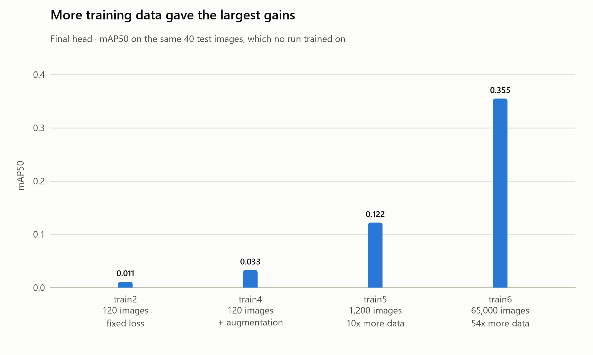
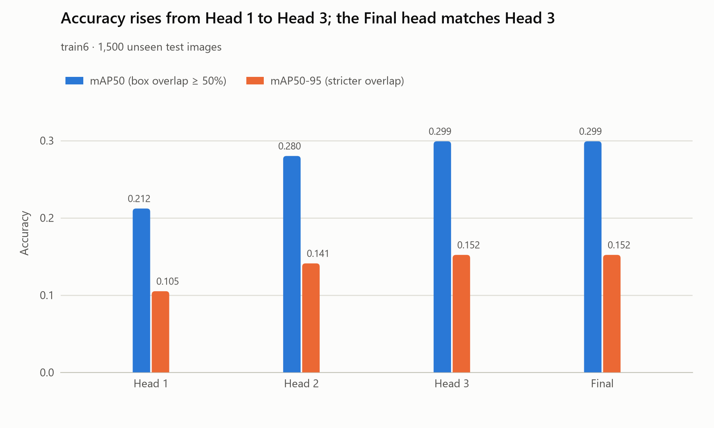
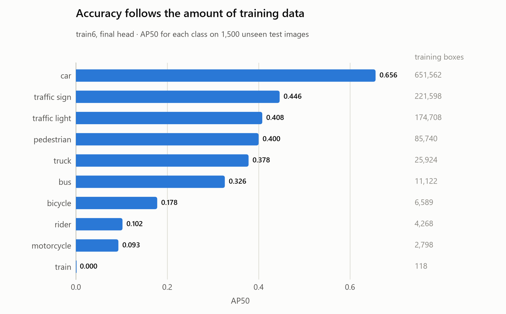
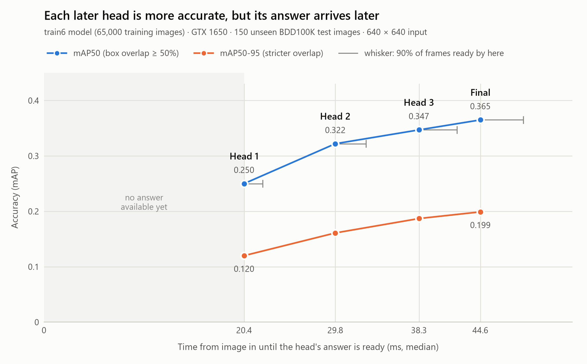
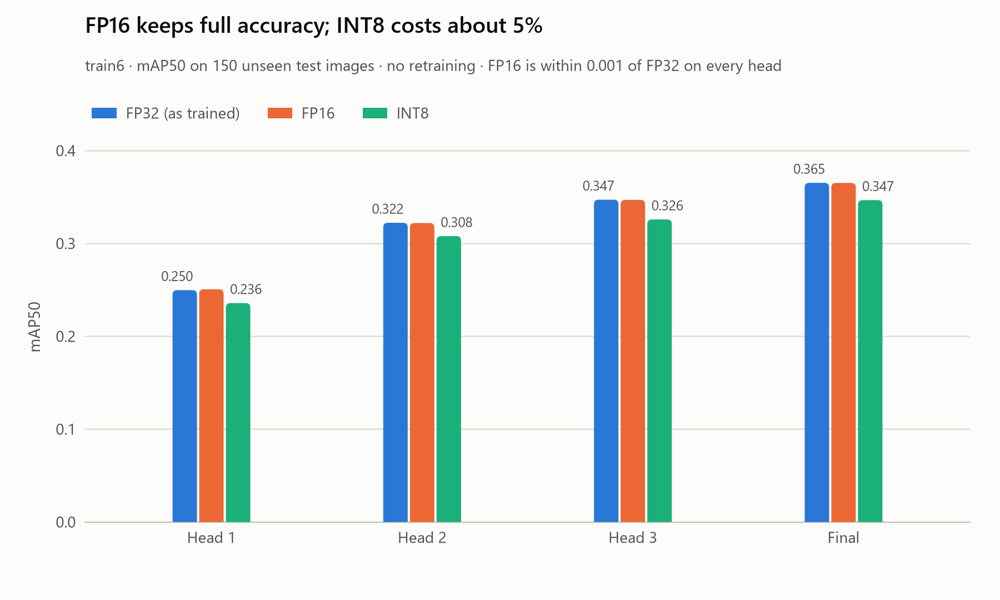
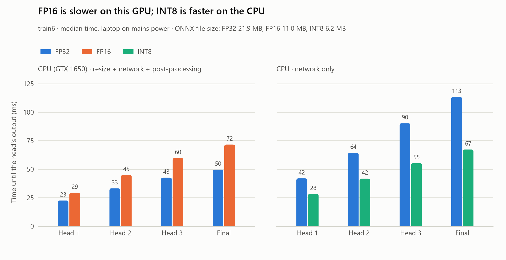
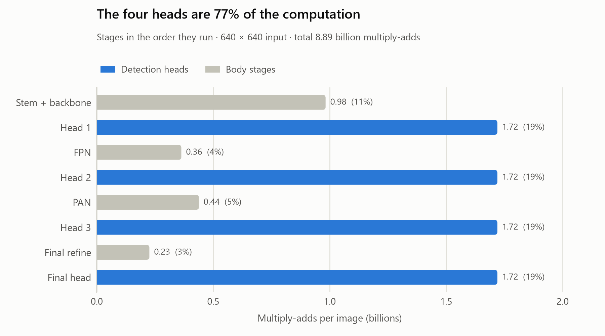

# Interrupt-Driven Anytime YOLO

An object detector for driving scenes that can be interrupted at any time.
One forward pass produces **four answers of increasing quality**. Each is
saved the moment it is ready, and an interrupt (a key press, a timer, or a
sensor reading) immediately gets the newest saved answer, without stopping
or re-running the network.

The long-term goal is an AI accelerator (hardware) that runs this model;
this repository defines and measures the workload.

For a step-by-step explanation in simple words, read
[PROJECT_EXPLAINED.md](PROJECT_EXPLAINED.md).

## Status (2026-10-04)

| Item | State |
|---|---|
| Interrupt framework | Working; 21 of 21 unit tests pass |
| Model | Small GELAN-style detector written from scratch: 5.45 M parameters, 151 conv layers, 8.89 G multiply-adds per 640 × 640 image |
| Best checkpoint | `runs/anytime_interrupt/train6_bdd70k/last.pt` (trained on 65,000 BDD100K images) |
| Accuracy | mAP50 **0.299**, mAP50-95 0.152 on 1,500 unseen images |
| Speed, GTX 1650 | Head 1 answer at 20.4 ms, Final at 44.6 ms (one image at a time) |

### What is not in this repository

- **Trained model files** (`*.pt`, `*.onnx`). They are about 42 MB each and
  stay on the author's machine. The per-run logs and validation results
  under `runs/` are included.
- **Datasets.** BDD100K must be downloaded separately; see "Datasets" below.
- **The Python environment** (`.venv/`). Recreate it as shown under "Setup".

The tests and the mock demos run without a trained model. Training, the
live demo and the timing scripts need a dataset, and a checkpoint that you
train yourself.

## Setup

Python 3.11. Run every command in this README **from the repository's top
folder** (the one that contains this file), because the code imports
itself as `anytime_yolo_interrupt.*`.

```bash
python -m venv .venv
```
```bash
.venv\Scripts\python -m pip install -r requirements.txt
```

`requirements.txt` installs the CUDA 12.4 build of PyTorch. On a machine
without an NVIDIA GPU, change `cu124` to `cpu` in that file.

In VS Code, open the top folder; `.vscode/` already holds run configs
(F5), the test explorer setup and tasks.

## Quick start

Run the tests:

```bash
.venv\Scripts\python -m pytest anytime_yolo_interrupt/tests -v
```

Live demo with the trained model: press Enter during a frame to interrupt
it and get the latest head's answer.

```bash
.venv\Scripts\python -m anytime_yolo_interrupt.scripts.interrupt_inference_live --checkpoint runs/anytime_interrupt/train6_bdd70k/last.pt --data-root "C:\Users\abhis\Downloads\bdd1500" --data-yaml "C:\Users\abhis\Downloads\bdd1500\data.yaml" --split test --device cuda
```

Add `--auto-interrupt-after-ms 30` to interrupt every frame automatically
after 30 ms instead of waiting for Enter.

Measure when each head's answer is ready:

```bash
.venv\Scripts\python -m anytime_yolo_interrupt.scripts.benchmark_latency --checkpoint runs/anytime_interrupt/train6_bdd70k/last.pt --data-root "C:/Users/abhis/Downloads/bdd1500" --split test --max-images 150
```

Train (augmentation is on by default):

```bash
.venv\Scripts\python -m anytime_yolo_interrupt.scripts.train --data-root "C:\Users\abhis\Downloads\bdd1500" --data-yaml "C:\Users\abhis\Downloads\bdd1500\data.yaml" --epochs 50 --batch-size 4 --device cuda --val-every 5 --log-dir runs/anytime_interrupt/my_run
```

## All scripts

| Script (`python -m anytime_yolo_interrupt.scripts.<name>`) | What it does |
|---|---|
| `train` | Train all four heads. Options: `--weights` (start from a model), `--resume` (continue a run), `--workers`, `--no-augment`, `--mosaic`, `--close-mosaic` |
| `interrupt_inference_live` | Press-Enter (or timed) interrupt demo with the real model; logs each fetched head's accuracy |
| `benchmark_latency` | Time from image in to each head's answer, through the real pipeline |
| `profile_heads` | Time every step separately: resize, backbone, each head, each post-processing |
| `export_onnx` | Export a checkpoint to ONNX (needed to view the network in Netron) |
| `quantize_compare` | Compare FP32, FP16 (GPU) and INT8 (CPU): per-head accuracy, time to each head, and model size |
| `profile_fp16_layers` | Time every layer on the GPU in FP32 and FP16, to show where FP16 loses time |
| `build_bdd_subset` | Build a train / calibration / test dataset from the full BDD100K download |
| `show_augmentations` | Save a grid of augmented training images with their boxes drawn |
| `demo_interrupt`, `detect`, `benchmark_anytime` | Demos and an interrupt-time sweep using the **mock** model (no trained weights or GPU needed) |

## How it works

```
Image
  │  resize to 640 × 640 (letterbox)
  ▼
Backbone ──► Head 1 ──► save answer #1      rough, earliest
  │
FPN      ──► Head 2 ──► save answer #2
  │
PAN      ──► Head 3 ──► save answer #3
  │
Refine   ──► Final  ──► save answer #4      best

                         latest answer  ◄──  interrupt reads this at any moment
```

The heads run **one after another**, not in parallel: each needs the
features of the stage before it. The network never exits early; every
stage always runs.

### Modules

All paths below are inside the `anytime_yolo_interrupt/` package folder.

| File | Responsibility |
|---|---|
| `models/gelan_anytime.py` | The model: stem, backbone, FPN, PAN, refine, and four detection heads |
| `models/common.py` | Building blocks: Conv, ELAN, Down, Up, SPPF |
| `models/detect_head.py` | Anchor-free decoupled head; decoding of raw outputs into boxes |
| `models/loss.py` | Per-head loss (objectness, class, CIoU box) with centre-sampling assignment |
| `models/postprocess.py` | Decode, filter, NMS |
| `data/yolo_dataset.py` | YOLO-format loader, letterboxing, training augmentation |
| `inference/anytime_detector.py` | The one-pass, four-tap loop, and the `AnytimeModelAdapter` interface |
| `inference/gelan_adapter.py` | Connects the real model to that loop |
| `inference/result_manager.py` | Thread-safe "latest answer" store with per-frame history; optional saving to disk on a background thread |
| `inference/interrupt_manager.py` | `trigger_interrupt()` and `get_latest_result()`; only reads |
| `inference/sensor_interface.py` | Turns a sensor value and a threshold into an interrupt |
| `inference/detection_result.py` | The frozen (immutable) result object |
| `evaluation/metrics.py` | Precision, recall, mAP50, mAP50-95 in NumPy |
| `tests/test_anytime.py` | The 21 unit tests |

### Three guarantees

1. **Not early-exit.** The loop in `AnytimeDetector.process_frame` has no
   "if interrupted, stop". The interrupt path is separate and never calls
   the model; it only reads the stored result.
2. **Never half-written.** A result is a frozen object. Saving one builds
   a new object and swaps a single reference under a lock, so a reader
   sees the old result or the new one, never a mix.
3. **Never stale.** Each frame clears the stored result when it starts,
   and a late result from an older frame is kept in history but never
   served as the current one. If nothing is ready yet, the reply is
   `NO DETECTION AVAILABLE YET`, not an empty result that looks real.

### Plugging in another model

Implement `AnytimeModelAdapter` (`run_shared_trunk`, `run_head`,
`postprocess`) and pass it to `AnytimeDetector`. Nothing else changes.
`MockAnytimeAdapter` is a stand-in with no real network, used by the
tests and the mock demos.

## Results

All numbers are for the final head unless a head is named. mAP is measured
at confidence ≥ 0.001.

### Training runs

| Run | Training data | Change | mAP50, same 40 unseen images |
|---|---|---|---|
| train1 | 120 images | original loss | 0 (confidence collapsed) |
| train2 | 120 images | fixed loss | 0.011 |
| train4 | 120 images | + augmentation | 0.033 |
| train5 | 1,200 images | 10× more data | 0.122 |
| train6 | 65,000 images | 54× more data | 0.355 |



On its own 1,500-image test set, train6 scores **0.299** (0.332 without
the "train" class, which has 3 test boxes). That is the most reliable
figure; 40 images is a noisy sample.

### Each head (train6, 1,500 unseen images)

| Head | mAP50 | mAP50-95 | Precision | Recall |
|---|---|---|---|---|
| Head 1 | 0.212 | 0.105 | 0.621 | 43.5% |
| Head 2 | 0.280 | 0.141 | 0.680 | 51.6% |
| Head 3 | 0.299 | 0.152 | 0.690 | 52.6% |
| Final | 0.299 | 0.152 | 0.695 | 52.8% |



Accuracy by class follows the amount of training data:



### Time vs accuracy (train6, GTX 1650, 150 unseen images)

| Head | Answer ready at (median) | mAP50 |
|---|---|---|
| Head 1 | 20.4 ms | 0.250 |
| Head 2 | 29.8 ms | 0.322 |
| Head 3 | 38.3 ms | 0.347 |
| Final | 44.6 ms | 0.365 |



These times are for frames that arrive in a steady stream, processed on
one long-lived worker thread. Three things make an answer arrive later:

- **A new thread for every frame** adds about 20 ms, because the GPU
  libraries set themselves up again in each new thread. Keep one worker
  thread alive (the live demo does).
- **A long idle gap** (about 200 ms or more) lets the laptop GPU drop into
  a low-power state; the next frame then takes about 34 ms to Head 1 and
  71 ms to the Final head. Gaps of 50 ms have no effect.
- **Saving results to disk** used to delay every later head by about 6 ms.
  Results are now written after the frame's final head, which costs
  nothing when there is any gap between frames and about 5 ms per frame
  when frames run back to back.

In the live demo with a fixed 50 ms interrupt, 60 of 150 frames had the
Final answer, 66 had Head 2, and 8 had nothing yet: the pauses between
its frames trigger the idle-gap effect on some of them.

### FP16 and INT8 (train6, no retraining, 150 unseen images)

| Version | Final-head mAP50 | ONNX file size | Final head ready at |
|---|---|---|---|
| FP32 | 0.365 | 21.9 MB | 49.6 ms on the GPU, 113.4 ms on the CPU |
| FP16 | 0.365 | 11.0 MB | 71.6 ms on the GPU |
| INT8 | 0.347 | 6.2 MB | 67.3 ms on the CPU |

GPU times are the whole pipeline; CPU times are the network only. File sizes are
measured on disk (`scripts/measure_model_sizes.py`).





### Where the computation goes



More charts (learning curves, the post-processing speed-up) are in
`docs/results/`. The full run history and how each number was measured
are in [PROJECT_EXPLAINED.md](PROJECT_EXPLAINED.md), section 8.

## Datasets

All data is from BDD100K (1280 × 720 dash-cam frames, YOLO-format labels).

| Set | Train / val / test | Location |
|---|---|---|
| old200 | 120 / 40 / 40 | `C:\Users\abhis\Downloads\archive (2)` |
| bdd1500 | 1,200 / 150 / 150 | `C:\Users\abhis\Downloads\bdd1500` |
| bdd70k | 65,000 / 1,500 / 1,500 | built on the cluster; rebuild with `build_bdd_subset` |

Class ids 0 to 9: pedestrian, rider, car, bus, truck, bicycle, motorcycle,
traffic light, traffic sign, train.

## Documents and pictures

| File | Contents |
|---|---|
| `PROJECT_EXPLAINED.md` | The whole project explained in simple words |
| `docs/model_architecture.png` (.svg, .pdf) | Full network diagram |
| `docs/head_architecture.png` (.svg, .pdf) | One detection head, with timelines |
| `docs/time_vs_accuracy.png` (.svg, .pdf) | Time vs accuracy chart |
| `docs/results/` | Result charts (.png, .svg); redraw them with `docs/make_result_charts.py` |
| `docs/weight_distribution/` | Weight value statistics and 64-bin histograms for all 151 convolution layers (CSV), as trained and with BatchNorm folded |
| `docs/parameter_study/` | Three inputs (head, number format, hardware) against five outputs: five graphs and a README explaining each |
| `docs/anytime_v8_fast/` | The same results for the fast anytime model on YOLOv8n: charts, parameter study with Excel sheet, layer-wise weight distribution, and a README explaining each |
| `docs/anytime_v8/` | The same results for the first anytime model on YOLOv8n (every head on every frame) |
| `docs/model_comparison/` | train6, anytime_v8, anytime_v8_fast, YOLOv8n and YOLOv8m measured in one run: charts, Excel sheet and README |
| `docs/accelerator_workload.csv` and `_summary.md` | Per-layer workload for accelerator design |
| `cluster/` | SLURM job script and notes for the cluster run |
| `backup_original/` | Files as they were before each fix |

## Known limitations

- **Trained from scratch.** mAP50 of about 0.30 is modest; a pretrained
  backbone is the largest remaining step.
- **Rare classes are weak**: rider and motorcycle are near 0.10, train is 0.
- **Heavy heads**: the four heads are 79% of the parameters and 77% of the
  compute, so every answer arrives later than it could.
- **Simple assignment and box regression** compared with YOLOv8/v9 (no
  task-aligned assignment, no DFL).
- **Timings are for one setup**: a laptop GTX 1650, batch 1, 640 × 640,
  post-processing on the CPU.
- **Not the official AnytimeYOLO or YOLOv9-T.** This is an independent
  implementation of the anytime idea; the `DKuhse/anytime-yolo` code is
  not used, and results are not directly comparable with published
  YOLOv9 numbers.
- **train6 was trained on a university cluster GPU, not on the laptop**
  (one GTX 1080 Ti, about 13 hours). The job script is in `cluster/`.
