# Results: anytime YOLOv8n

This folder has the same set of results as `docs/anytime_v8_fast/`, for
the **first anytime model built on YOLOv8n**. In this model every head is
computed on every frame. Every number was measured or counted. The file it
comes from is named in each section.

| Folder | Contents |
|---|---|
| `results/` | 7 charts (PNG + SVG): accuracy, time, classes, training, number formats, workload |
| `parameter_study/` | 5 graphs (three inputs, five outputs) and `parameter_study.xlsx` with every value |
| `weight_distribution/` | Weight statistics of all 90 layers (CSV), histograms and their [README](weight_distribution/README.md) |

## The model

- **Checkpoint:** `runs/anytime_v8/bdd1500/weights/best.pt`. It was
  trained with `train_anytime_v8 --name bdd1500`, starting from the
  COCO-pretrained YOLOv8n: 50 epochs, 36 minutes, 1,200 training images.
- **The whole network is trained together** with the two early heads. The
  three losses are added with weights 0.3 (Head 1), 0.6 (Head 2) and 1.0
  (Final).
- **Two early heads**, each with one full 3×3 convolution (32 channels)
  per branch:
  - Head 1 reads layers 4, 6 and 9 (backbone).
  - Head 2 reads layers 15, 12 and 9 (after the FPN).
- **Every head runs on every frame**, so the Final answer waits for both
  early heads.
- **Parameters:** 3,666,058. YOLOv8n has 3,134,894 (the two early heads
  add 531,164).

## How everything was measured

The same method as for the fast model:

| What | Details |
|---|---|
| Test images | First 150 images of the `bdd1500` test split, never used in training. Input 640 × 384 |
| Accuracy | This project's metric code, confidence ≥ 0.001, NMS IoU 0.7, up to 300 boxes |
| GPU | NVIDIA GTX 1650 laptop, PyTorch, BatchNorm folded into the convolutions |
| GPU time | Image in to boxes on the CPU (resize, network, NMS), first 60 test images, median. Each head's time is when its boxes are ready inside one full pass |
| CPU time | Network only, ONNX Runtime, on the graph cut after that head (earlier heads included), 60 images, median of 3 interleaved repeats |
| INT8 | ONNX Runtime static QDQ: 8-bit weights per output channel, 8-bit activations, MinMax ranges from 100 calibration images |
| Power | Mains power for all timing |

**Sources:**
- `runs/anytime_v8/study_v8/results.json`, from `scripts/study_anytime_v8.py --eager`
- `runs/anytime_v8/evaluation.json`, from `scripts/evaluate_anytime_v8.py`. This is the run that compares against YOLOv8n.

## 1. Accuracy of each head (`results/per_head_accuracy.png`)

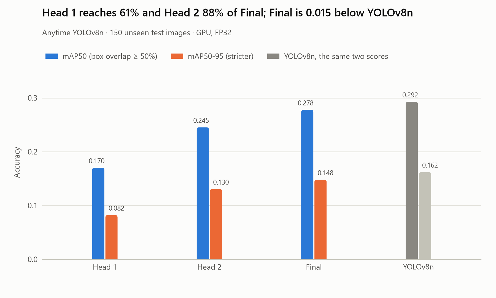

| | Head 1 | Head 2 | Final | YOLOv8n |
|---|---|---|---|---|
| mAP50 | 0.1700 | 0.2452 | 0.2776 | 0.2925 |
| mAP50-95 | 0.0821 | 0.1303 | 0.1478 | 0.1619 |
| Precision | 0.828 | 0.853 | 0.884 | 0.862 |
| Recall | 0.246 | 0.332 | 0.330 | 0.326 |

- **Head 1 reaches 61%** and **Head 2 88%** of the Final head's mAP50.
  These early heads are much better than the fast model's (33% and 63%).
- **The Final head is 0.015 mAP50 below YOLOv8n.** Training the backbone
  for the early heads too costs the Final head some accuracy.

## 2. Time against accuracy (`results/time_vs_accuracy.png`)

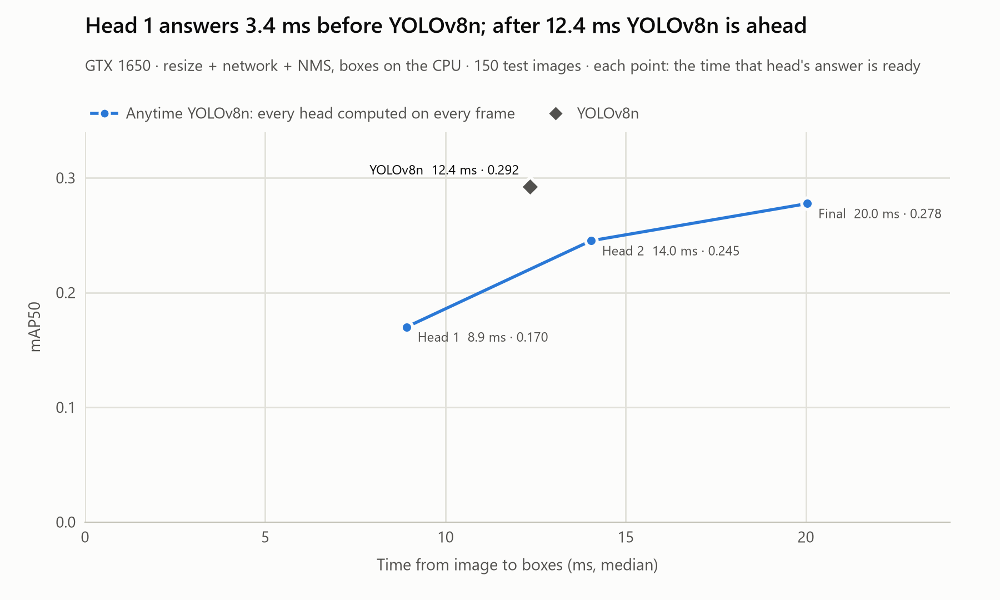

Source: `evaluation.json`, 150 images.

| | Head 1 | Head 2 | Final |
|---|---|---|---|
| Answer at | 8.92 ms | 14.04 ms | 20.04 ms |
| YOLOv8n | | | 12.35 ms |

- **Head 1 answers 3.4 ms before YOLOv8n**, with 58% of its mAP50.
- **From 12.4 ms on, YOLOv8n is better.** Head 2 and the Final head come
  later than YOLOv8n and are less accurate.
- **Frames per second:** 49.0, against 73.9 for YOLOv8n in the same run.

## 3. Each class (`results/per_class_accuracy.png`)

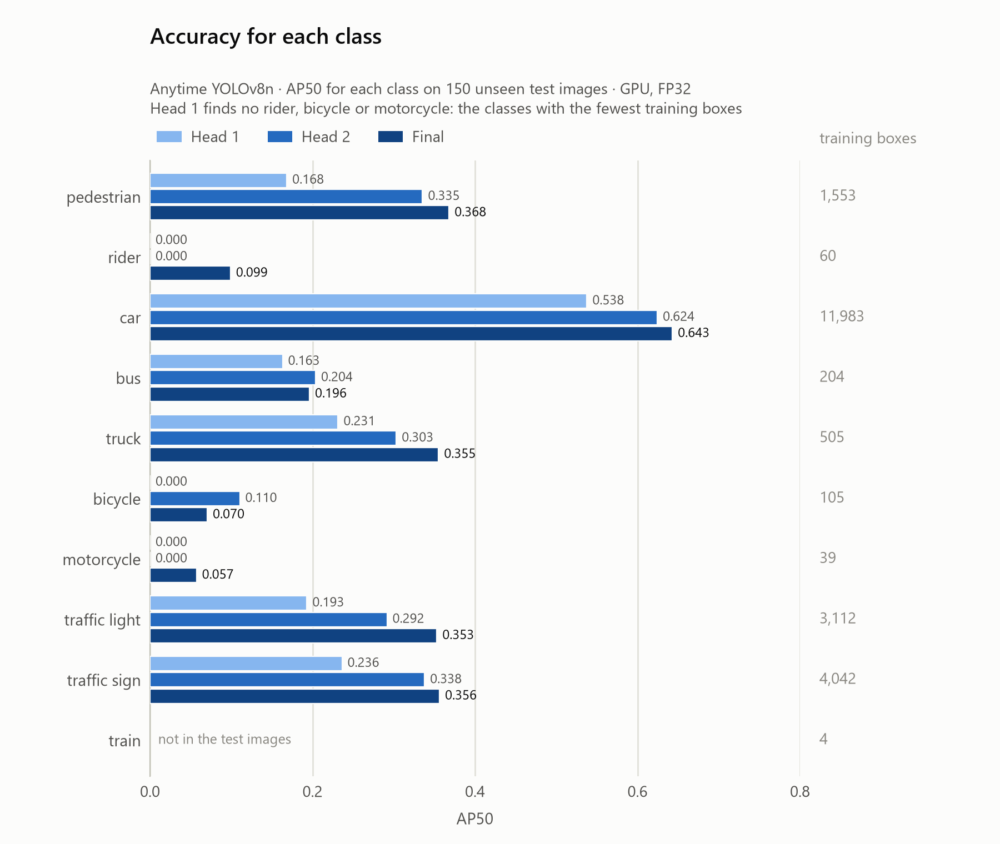

AP50 on GPU, FP32. "Training boxes" is the number of boxes of that class
in the 1,200 training images.

| Class | Head 1 | Head 2 | Final | Training boxes |
|---|---|---|---|---|
| pedestrian | 0.168 | 0.335 | 0.368 | 1,553 |
| rider | 0.000 | 0.000 | 0.099 | 60 |
| car | 0.538 | 0.624 | 0.643 | 11,983 |
| bus | 0.163 | 0.204 | 0.196 | 204 |
| truck | 0.231 | 0.303 | 0.355 | 505 |
| bicycle | 0.000 | 0.110 | 0.070 | 105 |
| motorcycle | 0.000 | 0.000 | 0.057 | 39 |
| traffic light | 0.193 | 0.292 | 0.353 | 3,112 |
| traffic sign | 0.236 | 0.338 | 0.356 | 4,042 |
| train | not in the test images | | | 4 |

- **Head 1 finds no rider, bicycle or motorcycle**, the classes with the
  fewest training boxes.
- **For bus and bicycle, Head 2 is better than the Final head.**

## 4. Training (`results/learning_curves.png`)

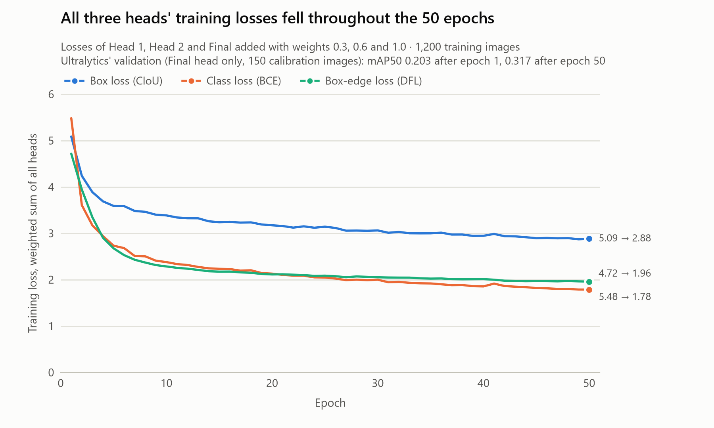

Source: `runs/anytime_v8/bdd1500/results.csv`. The curves are the
weighted sum of all three heads' losses.

| Loss | Epoch 1 | Epoch 50 |
|---|---|---|
| Box (CIoU) | 5.09 | 2.88 |
| Class (BCE) | 5.48 | 1.78 |
| Box edge (DFL) | 4.72 | 1.96 |

Ultralytics' validation checks only the Final head: mAP50 0.203 after
epoch 1 and 0.317 after epoch 50, the best epoch (so `best.pt` is
epoch 50).

## 5. Number formats: accuracy (`results/quantization_accuracy.png`)

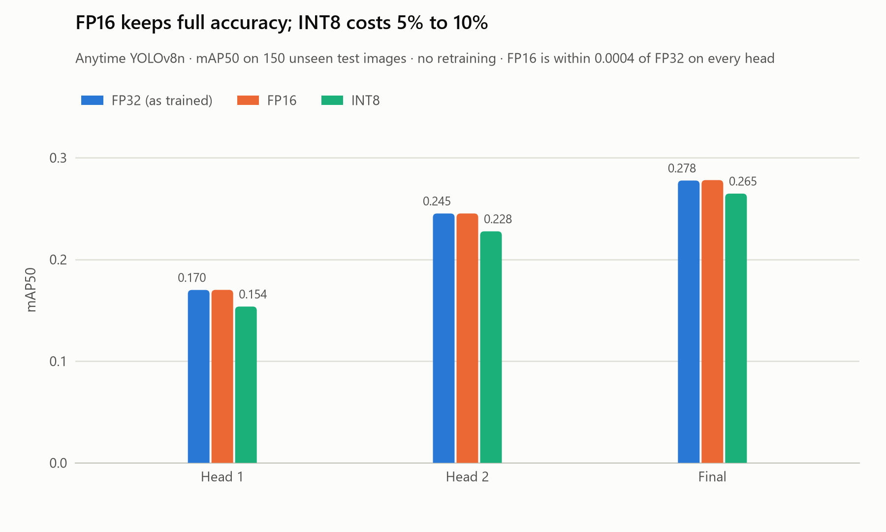

| mAP50 | GPU FP32 | GPU FP16 | CPU FP32 | CPU INT8 | INT8 loss |
|---|---|---|---|---|---|
| Head 1 | 0.1700 | 0.1701 | 0.1700 | 0.1537 | 9.6% |
| Head 2 | 0.2452 | 0.2452 | 0.2452 | 0.2276 | 7.2% |
| Final | 0.2776 | 0.2780 | 0.2776 | 0.2647 | 4.6% |

| mAP50-95 | GPU FP32 | GPU FP16 | CPU FP32 | CPU INT8 |
|---|---|---|---|---|
| Head 1 | 0.0821 | 0.0822 | 0.0821 | 0.0737 |
| Head 2 | 0.1303 | 0.1297 | 0.1303 | 0.1182 |
| Final | 0.1478 | 0.1479 | 0.1478 | 0.1389 |

- **FP16 keeps full accuracy:** within 0.0004 mAP50 of FP32 on every head.
- **INT8 costs 4.6 to 9.6% mAP50**, with no retraining. That is less than
  the fast model (7.6 to 14.2%).
- **FP32 on the CPU gives the same accuracy as on the GPU**, so the
  exported graphs are correct.

## 6. Number formats: time (`results/quantization_latency.png`)

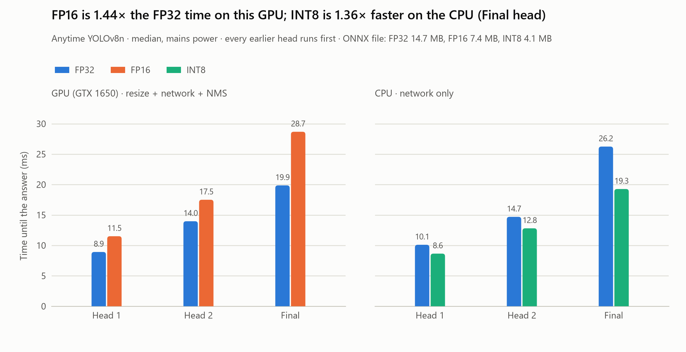

| Median (ms) | GPU FP32 | GPU FP16 | CPU FP32 | CPU INT8 |
|---|---|---|---|---|
| Head 1 | 8.92 | 11.51 | 10.10 | 8.65 |
| Head 2 | 13.97 | 17.50 | 14.70 | 12.81 |
| Final | 19.86 | 28.68 | 26.24 | 19.27 |

- **FP16 is slower on this GPU:** 1.44× the FP32 time for the Final head
  (the GTX 1650 has no Tensor Cores).
- **INT8 is 1.36× faster on the CPU** for the Final head.
- **Frames per second (60 images):** 51.1 in FP32, 34.7 in FP16.
- GPU times include resize and NMS, CPU times are the network only, so
  compare formats within one device.

## 7. Computation by stage (`results/workload_by_stage.png`)

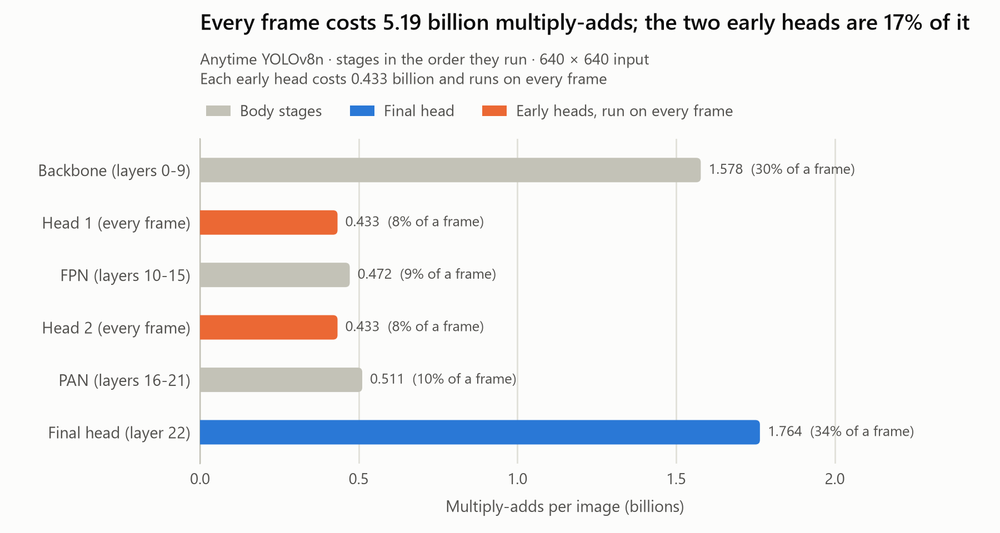

Multiply-adds for one 640 × 640 image.

| Stage | Multiply-adds | Share of a frame | Parameters |
|---|---|---|---|
| Backbone (layers 0-9) | 1,577,779,200 | 30.4% | 1,270,144 |
| Head 1 (every frame) | 433,305,600 | 8.3% | 265,582 |
| FPN (layers 10-15) | 471,859,200 | 9.1% | 184,896 |
| Head 2 (every frame) | 433,305,600 | 8.3% | 265,582 |
| PAN (layers 16-21) | 511,180,800 | 9.8% | 800,064 |
| Final head (layer 22) | 1,764,134,400 | 34.0% | 879,790 |

- **Every frame costs 5.192 billion multiply-adds**: YOLOv8n's 4.325
  billion plus 0.867 billion for the two early heads (17%).
- The fast model's depthwise heads cost 0.079 billion each instead of
  0.433, and only on interrupt.

## 8. Parameter study: three inputs, five outputs (`parameter_study/`)

The three inputs are the head that answers (x-axis), the number format
(line colour) and the hardware (left panel GPU, right panel CPU). FP16
was run only on the GPU and INT8 only on the CPU.

| Output | Graph | Values |
|---|---|---|
| mAP50 | 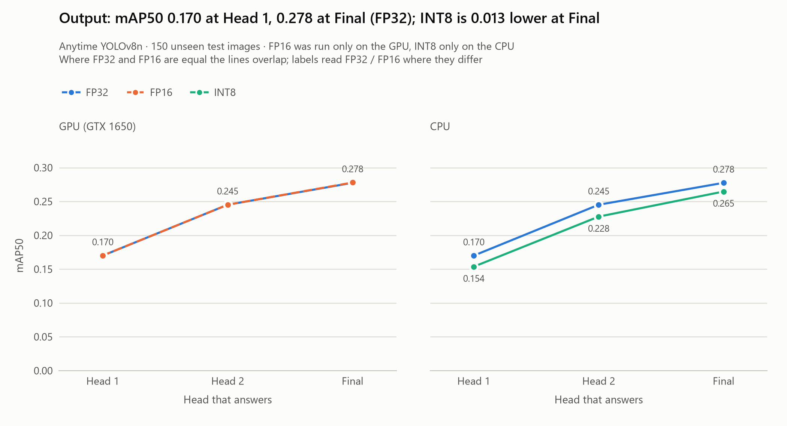 | Section 5 |
| mAP50-95 | 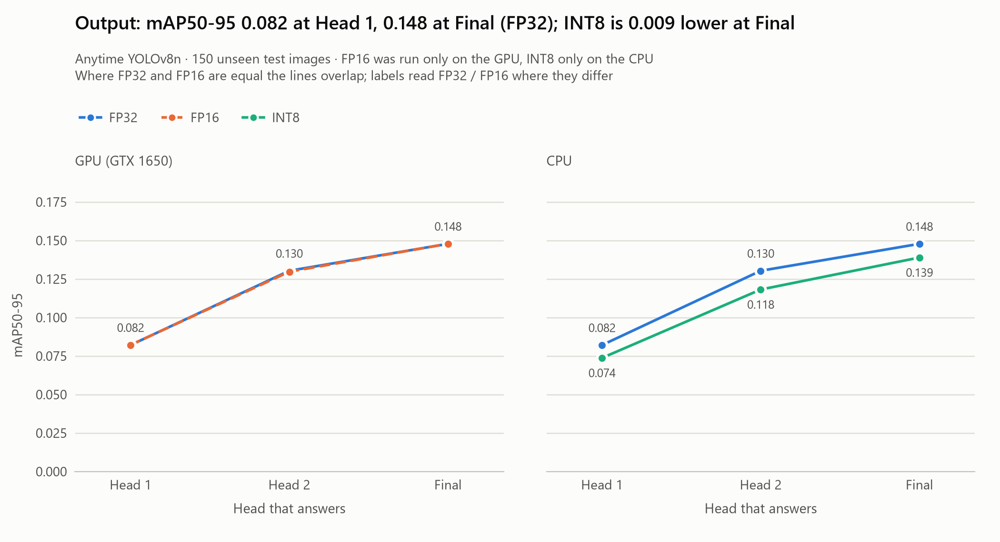 | Section 5 |
| Time until the answer | 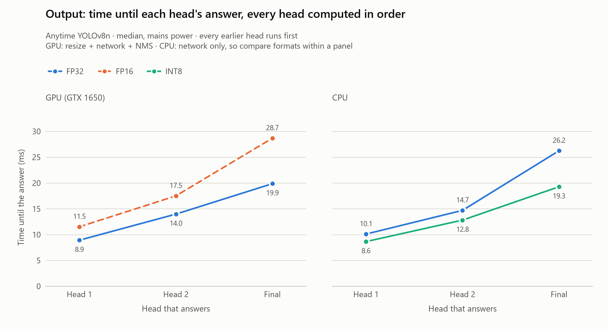 | Section 6 |
| Model file size | 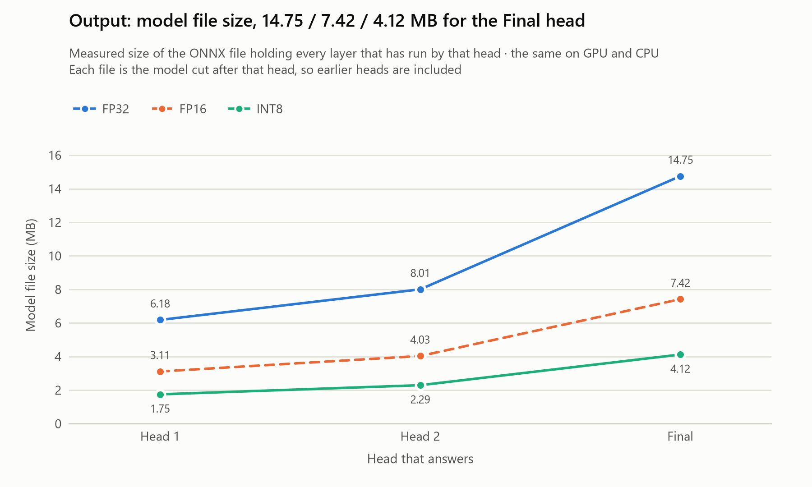 | Below |
| Multiply-adds | 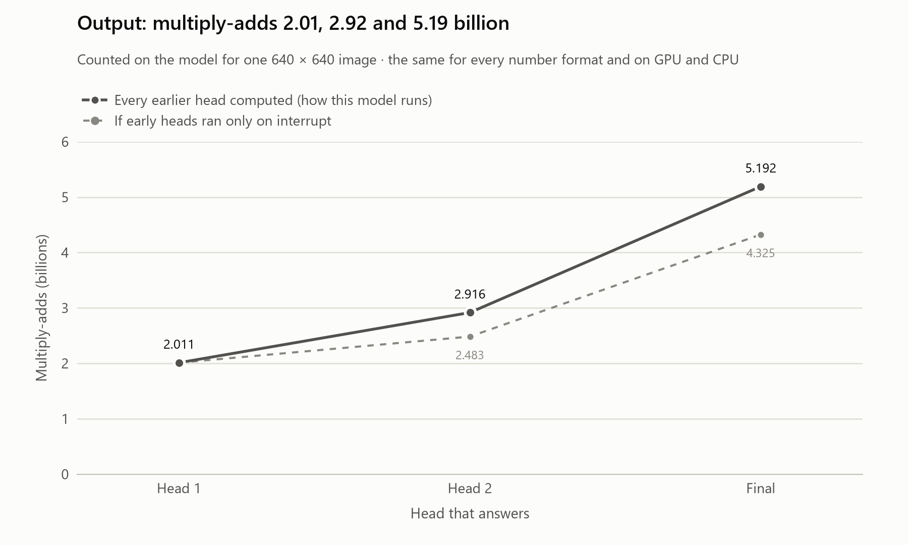 | Below |

**File size**, measured on disk. Each ONNX file is the model cut after
that head, so earlier heads are included.

| MB | FP32 | FP16 | INT8 |
|---|---|---|---|
| Head 1 | 6.184 | 3.112 | 1.748 |
| Head 2 | 8.006 | 4.033 | 2.294 |
| Final | 14.751 | 7.419 | 4.122 |
| Whole model | 14.726 | 7.394 | 4.072 |

The PyTorch state_dict is 14.86 MB in FP32 and 7.48 MB in FP16. The
checkpoint file `best.pt` is 7.59 MB (Ultralytics stores it in FP16).

**Multiply-adds up to each answer:**

| | Every earlier head computed (how this model runs) | Only the layers that head needs |
|---|---|---|
| Head 1 | 2.011 billion | 2.011 billion |
| Head 2 | 2.916 billion | 2.483 billion |
| Final | 5.192 billion | 4.325 billion |

**`parameter_study/parameter_study.xlsx`** holds every value above.
Measured values are in blue; differences, ratios and shares are Excel
formulas in black. Sheets: Read me, mAP50, mAP50-95, Per-class AP50,
Latency, File size, Multiply-adds.

## 9. Weight distribution (`weight_distribution/`)

Statistics and 64-bin histograms of all 90 convolution layers, as trained
and with BatchNorm folded in. See its
[README](weight_distribution/README.md). In short:
- **Folded ranges differ by about 111×** between layers, from 0.211 to
  23.54.
- **The early heads have small folded weights** (largest 0.654).

## Regenerate

```bash
.venv\Scripts\python -m anytime_yolo_interrupt.scripts.study_anytime_v8 --eager --checkpoint runs/anytime_v8/bdd1500/weights/best.pt --data-root "C:/Users/abhis/Downloads/bdd1500" --work-dir runs/anytime_v8/study_v8
```
```bash
.venv\Scripts\python docs/make_anytime_v8_charts.py
```
```bash
.venv\Scripts\python docs/make_anytime_v8_fast_xlsx.py --v8
```
